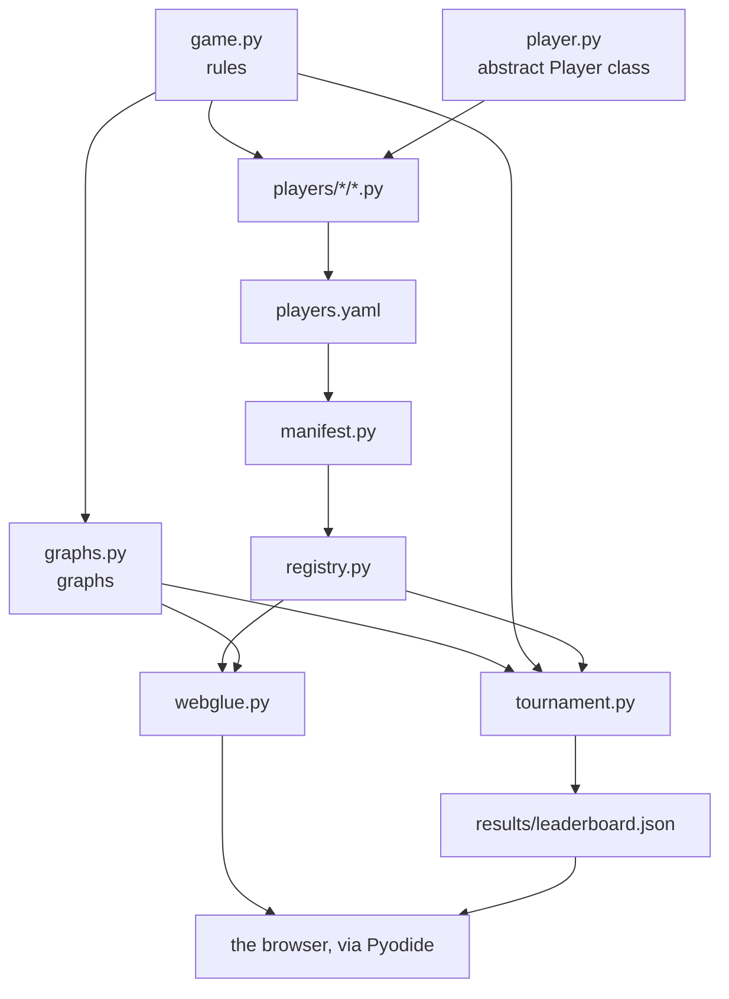

# Code structure

The repository has **six places to look**. Everything else hangs off them.

```text
blackhole-arena/
├── src/blackholearena/  the package: rules, graphs, player API, tournament
│   └── bots/            the reusable strategies
├── players/             one .py file per player
│   ├── builtin/         the reference ladder (random, easy and three searches)
│   └── custom/          players submitted by PR
├── results/             leaderboard.json, written by the tournament
├── web/                 the GitHub Pages site (Pyodide + thin JS)
├── docs/                this documentation (MkDocs + Material)
└── tests/               the pytest suite
```

---

## Inside the package

| Module | What it does |
|---|---|
| `game.py` | the pure rules: `legal_moves`, `apply_move`, `is_terminal`, `black_hole`, `scores`, `scores_if_hole` |
| `graphs.py` | ready-made graphs: `classic`, `wheel`, `grid`, `random_graph` and the web `PRESETS` |
| `player.py` | the abstract `Player` class — [the API other people implement](../upload-a-bot/player-api.md) |
| `registry.py` | in-memory catalogue, name → `Player` |
| `manifest.py` | loads the `players.yaml` manifests into the registry |
| `tournament.py` | formats, timing, points-based scoring and results |
| `elo.py` | per-game Elo rating, treating each game as won, drawn or lost |
| `bots/` | the reusable strategies: `random_bot.py` (`RandomBot`, the base of `random`), `neighbour_bot.py` (`FreeNeighbourBot`, the base of `easy`), `search.py` (`SearchBot`, the alpha-beta search with memoization), `aggressive.py` (`MaxOwnBot` and `MinRivalBot`, the bases of `aggressive-max` and `aggressive-min`) and `cooperative.py` (`CooperativeBot`, the base of `cooperative`) |

---

## How the pieces fit



---

## Four design decisions

| Decision | Why |
|---|---|
| **`apply_move` returns a new state** and never mutates its input | a search (such as minimax) explores many hypothetical futures; shared mutable state would be a subtle source of bugs |
| **State is a plain dict** (`edges`, `owner`, `tiles`) and a move is an `int` | the same value crosses Python → JS → Python (Pyodide) with no custom serialization; who moves and how many tiles they place are derived from the state, so it can never contradict itself |
| **Timing lives in the tournament**, not in the player or the game | the contract an outsider implements stays tiny; timing is a property of the *game* |
| **Discovery is an explicit manifest**, not a folder scan | the trust boundary is visible in a single diff, and a stranger's code is not run just to be discovered |

---

**Next:** [API reference](api.md) — every public name, generated from the
source.
