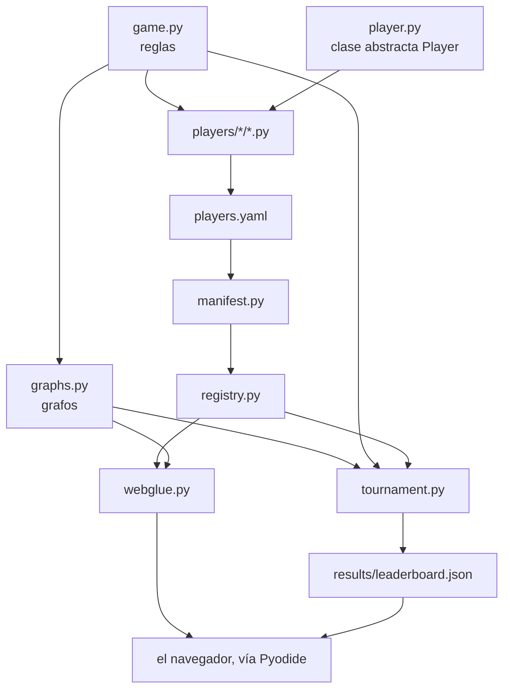

# Estructura del código

El repositorio tiene **seis sitios donde mirar**. Todo lo demás cuelga de ellos.

```text
blackhole-arena/
├── src/blackholearena/  el paquete: reglas, grafos, API de jugador, torneo
│   └── bots/            las estrategias reutilizables
├── players/             un archivo .py por jugador
│   ├── builtin/         la escalera de referencia (random, easy y tres búsquedas)
│   └── custom/          los jugadores enviados por PR
├── results/             leaderboard.json, escrito por el torneo
├── web/                 la página de GitHub Pages (Pyodide + JS fino)
├── docs/                esta documentación (MkDocs + Material)
└── tests/               la batería de pytest
```

---

## El paquete, por dentro

| Módulo | Qué hace |
|---|---|
| `game.py` | las reglas puras: `legal_moves`, `apply_move`, `is_terminal`, `black_hole`, `scores`, `scores_if_hole` |
| `graphs.py` | grafos listos para jugar: `classic`, `wheel`, `grid`, `random_graph` y los `PRESETS` de la web |
| `player.py` | la clase abstracta `Player` — [la API que implementan otros](../upload-a-bot/player-api.md) |
| `registry.py` | catálogo en memoria, nombre → `Player` |
| `manifest.py` | carga los manifiestos `players.yaml` en el registro |
| `tournament.py` | formatos, tiempos, puntuación por puntos y resultados |
| `elo.py` | puntuación Elo por partida, tratando cada partida como ganada, empatada o perdida |
| `bots/` | las estrategias reutilizables: `random_bot.py` (`RandomBot`, la base de `random`), `neighbour_bot.py` (`FreeNeighbourBot`, la de `easy`), `search.py` (`SearchBot`, la búsqueda alfa-beta con memoización), `aggressive.py` (`MaxOwnBot` y `MinRivalBot`, las de `aggressive-max` y `aggressive-min`) y `cooperative.py` (`CooperativeBot`, la de `cooperative`) |

---

## Cómo encajan las piezas



---

## Cuatro decisiones de diseño

| Decisión | Por qué |
|---|---|
| **`apply_move` devuelve un estado nuevo** y nunca muta la entrada | una búsqueda (como minimax) explora muchos futuros hipotéticos; un estado mutable compartido sería una fuente sutil de errores |
| **El estado es un diccionario simple** (`edges`, `owner`, `tiles`) y la jugada un `int` | el mismo valor cruza Python → JS → Python (Pyodide) sin serialización propia; quién mueve y cuántas fichas coloca se deducen del estado, así que nunca puede contradecirse |
| **Los tiempos viven en el torneo**, no en el jugador ni en el juego | el contrato que implementa alguien de fuera se mantiene diminuto; el control de tiempo es una propiedad de la *partida* |
| **El descubrimiento es un manifiesto explícito**, no un escaneo de carpeta | la frontera de confianza es visible en un solo diff, y el código de un desconocido no se ejecuta solo para ser descubierto |

---

**Siguiente:** [Referencia de la API](api.md) — todos los nombres públicos,
generados desde el código fuente.
