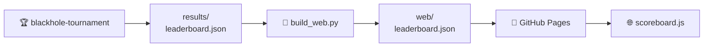

# The scoreboard

The scoreboard is not a program. It is **one JSON file** written by the
tournament and read by the web page. Nothing else connects them: no database, no
backend, no API.

---

## The path the data takes



| Step | What happens |
|---|---|
| 1 · **A run produces it** | `blackhole-tournament --out results/leaderboard.json` plays every game and dumps one JSON object. The workflow commits the file to the repository |
| 2 · **The build copies it** | `scripts/build_web.py` drops it next to the page as `web/leaderboard.json`. If it does not exist yet, it warns and carries on |
| 3 · **Pages serves it** | the Pages workflow uploads the whole `web/` directory as a static artifact |
| 4 · **The page fetches it** | `scoreboard.js` calls `fetch("leaderboard.json", { cache: "no-cache" })` on load. If it fails, the screen says *“No leaderboard yet…”* instead of breaking |

!!! info "Why a versioned file and not a database"
    A static page cannot query anything. Keeping the results as a file in the
    repository means the scoreboard has no infrastructure to keep alive, the
    history of every published run is in `git log`, and anyone can reproduce a
    run locally and compare.

---

## What is in the file

Eight top-level keys, always present:

| Key | What it holds |
|---|---|
| `generated_at` | UTC timestamp of the run |
| `config` | the settings the run used — enough to reproduce it |
| `players` | the player directory: one entry per **type**, with icon, authors and description |
| `standings` | the ordered ranking — the table itself |
| `matches` | one entry per tie, aggregated over its games |
| `player_stats` | per-player detail, including head-to-head |
| `totals` | whole-run counters for the summary boxes |
| `structure` | format-specific: groups and bracket in a championship |

This is one `standings` row, which is the part you will actually look at:

```json
{
  "rank": 1, "player": "random_1",
  "points": 55, "avg_points": 3.056, "points_against": 54,
  "wins": 7, "draws": 4, "losses": 7, "forfeits": 0,
  "games": 18, "win_rate": 0.389,
  "avg_move_ms": 0.018, "std_move_ms": 0.002, "max_move_ms": 0.025,
  "elo": 1519.243
}
```

| Field | What it is |
|---|---|
| `points` | **the ranking criterion**: the sum of what it scored over all its games |
| `avg_points` | points per game |
| `points_against` | what its opponents scored in those same games |
| `wins` / `draws` / `losses` | games in which it scored more than, the same as, or less than the opponent — **informational only** |
| `win_rate` | fraction of games in which it outscored the opponent |
| `forfeits` | games it forfeited |

`elo` is always there, in every format: it is computed by treating each game as won, drawn or lost. It only decides the ranking in a `league` run with Elo enabled.

??? info "The remaining blocks, with examples"
    **`config`** — how the run was configured. The page reads
    `config.tournament` to decide which blocks to render.

    ```json
    "config": {
      "tournament": "league",
      "graphs": [
        { "nodes": 5, "edges": [[0, 1], [2, 3], [3, 4], [0, 2], [0, 3], [1, 3], [1, 4]] },
        { "nodes": 7, "edges": [[0, 1], [0, 2], [0, 3], [0, 4], [0, 5], [0, 6],
                                [1, 2], [2, 3], [3, 4], [4, 5], [5, 6], [1, 6]] },
        { "nodes": 9, "edges": [[0, 1], [0, 3], [1, 2], [1, 4], [2, 5], [3, 4],
                                [3, 6], [4, 5], [4, 7], [5, 8], [6, 7], [7, 8]] }
      ],
      "repetitions": 3,
      "game_budget_ms": 2000,
      "build_budget_ms": 2000,
      "elo": true,
      "player_copies": { "random": 2 }
    }
    ```

    **`players`** — the directory, one entry per type. It exists so the
    scoreboard is **self-contained**: the page renders icons, authors and
    descriptions straight from the file, without importing the Python registry.
    A six-month-old scoreboard still renders correctly.

    ```json
    { "name": "random", "icon": "🎲", "authors": ["builtin"],
      "description": "Places its tiles on a free node chosen uniformly at random…" }
    ```

    **`matches`** — one row per pairing, with each side's points summed over
    all its games. `winner` is whoever collected more points, or the empty
    string on a tie. Timings (`a_avg_move_ms`, …) are **aggregates only** (mean,
    standard deviation and max): a per-move array would produce a file too large
    to download on every page load.

    ```json
    { "player_a": "random_0", "player_b": "random_1", "phase": "round-robin",
      "games": 18, "a_points": 54, "b_points": 55,
      "a_wins": 7, "b_wins": 7, "draws": 4, "winner": "random_1", "forfeits": 0 }
    ```

    **`player_stats`** — everything in `standings`, plus `moves_made`, the build
    timings and an `opponents` list, which is where each card's head-to-head
    breakdown comes from.

    ```json
    { "opponent": "random_1", "games": 18, "points": 54, "points_against": 55,
      "wins": 7, "draws": 4, "losses": 7 }
    ```

    **`totals`** — the counters behind the summary boxes: players, ties, games,
    total points (`total_points`) and points per game (`avg_game_points`), total
    moves, longest game and forfeits.

    **`structure`** — for `simple` and `league` it is just a marker
    (`{"type": "league", "elo": true}`). For `championship` it carries the group
    tables (ranked by points), the bracket rounds and the champion. Every
    knockout tie keeps each side's points:

    ```json
    { "a": "random_0", "b": "random_1", "a_points": 18, "b_points": 11,
      "winner": "random_0" }
    ```

!!! note "`standings` uses `random_0`; `players` uses `random`"
    A type can enter the tournament more than once, and each copy is named
    `<type>_<seed>`. `standings`, `matches` and `player_stats` use those roster
    names; `players` uses the type. The page splits them apart again to draw
    `🎲 random₀`.

---

## What the page draws with it

Purely mechanical rendering, no game logic:

- 🏅 a **points-based standings** column with 🥇🥈🥉 for the top three;
- 🎯 a **player filter** and a **radar chart** comparing the selected ones on
  four axes: **points**, **Elo**, **win rate** and **average move time**
  (inverted: faster reaches further out);
- 🗂️ a collapsible **tournament structure** block (championship only);
- ⚔️ a **tie summary** table;
- 🃏 expandable **per-player stats** cards;
- 📈 **total stats** boxes.

---

## Produce one yourself

```bash
blackhole-tournament --out results/leaderboard.json   # write it
python scripts/build_web.py                          # copy it next to the page
python -m http.server -d web 8000                    # serve it and look
```

---

**Next:** [The web app](web.md) — the page that renders it.
