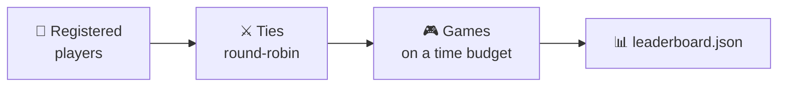

# The tournament

The tournament runs **every registered player** against every other and writes a
results file that the [web app](web.md) renders as a scoreboard.



You run it yourself with `blackhole-tournament`, and a scheduled GitHub Action
runs it too.

---

## How it scores: by points

BlackHole [is not a zero-sum game](../rules.md#it-is-not-a-zero-sum-game): in
every game **both players score**, and each one tries to maximize its own
score. So the tournament does not count games won, it counts **points**:

```text
a player's points = the sum of what it scored in all its games
```

Who outscored whom in each game (wins, draws and losses) is still recorded, but
**only as information**: it does not decide the ranking.

!!! example "Why winning is not enough"
    A player that wins every game 1 to 0 collects fewer points than one that
    loses every game 5 to 6. BlackHole rewards **scoring a lot**, not finishing
    above your opponent.

---

## A “tie” is many games

Two players do not play one game: they play a **series**. For each starting
graph, and with each of them moving first once, `--repetitions` games are
played.

```text
games in a tie = number of graphs × 2 × repetitions
```

With the defaults (3 graphs, 3 repetitions) that is **18 games** per pair. The
three default graphs are deliberately different:

| Graph | Nodes | *N* (turns per player) | *M* (tiles per player) |
|---|---|---|---|
| `classic()` — the example from the [rules](../rules.md) | 5 | 2 | 3 |
| `wheel(7)` — a hub joined to a ring of 6 | 7 | 3 | 6 |
| `grid(3, 3)` — a 3×3 grid | 9 | 4 | 10 |

!!! info "Why who starts is alternated"
    In BlackHole, moving first or second changes the game a lot: for instance,
    the second player makes the last move and chooses which of the last two
    free nodes becomes the black hole. Without alternating, the tournament
    would measure the draw instead of the skill.

---

## The three formats

| Format | Pairings | Ranking |
|--------|----------|---------|
| `simple` *(default)* | round-robin, each pair once | points |
| `league` | round-robin, each pair once | Elo rating |
| `championship` | group stage + knockout bracket | points and a champion |

Pick one with `--tournament`.

??? info "Detail of `league` and `championship`"
    **`league`** uses the same round-robin as `simple`, but ranks by an
    [Elo rating][blackholearena.elo] updated game by game (K=32, start 1500).
    Elo treats each game **as if it were zero-sum**: whoever scores more wins
    (1), whoever scores less loses (0), and equal scores are a draw (0.5). The
    margin does not count — that is what points are for. `--no-elo` falls back
    to points.

    Elo is computed and published **in every format**; it only decides the
    ranking in `league`.

    **`championship`** splits the players into balanced **groups of four**; each
    group plays a round-robin, is ranked by **points**, and its **top two
    advance** to a seeded knockout bracket (with byes for the top seeds when the
    count is not a power of two). Each knockout round is a full tie, and **the
    player with more points** over it advances; on equal points, the higher
    seed goes through.

??? info "Why a player can show up as `random_0` and `random_1`"
    A player type can be entered **more than once**, each copy with its own
    seed, which is what lets a type compete against *itself* — a round-robin
    never pairs an instance with itself. Copies are named `<type>_<seed>`, and
    the scoreboard renders that suffix as a subscript.

    Reference players are entered **twice** and PR submissions **once**, because
    the submission side grows with every merged PR and the work grows with the
    square of the roster. `--player-repetition` overrides it.

---

## Robustness: one bad bot never breaks the run

Even well-meaning bots can hang, crash or return an illegal move in some corner
case. The tournament survives all of it:

| Failure | Recorded as |
|---------|-------------|
| goes over its game budget, or hangs | `forfeit_timeout` |
| raises an exception while playing | `forfeit_error` |
| returns an illegal or malformed move | `forfeit_illegal` |
| `create()` goes over the budget | `forfeit_build_timeout` |
| `create()` raises an exception | `forfeit_build_error` |

A forfeit cuts the game short, so there is no black hole to score. Instead,
**the offender scores 0** and **its opponent scores the maximum** possible on
that graph, *M* (`tiles_per_player`): meeting a broken bot never costs the
innocent side. In every case the reason is recorded and the run **continues**.

---

## The time budgets

Each player gets **two budgets per game**, not per move:

| Budget | Default | Covers |
|---|---|---|
| game (`--game-time-limit`) | 2 s | all your thinking time in that game, cumulative |
| build (`--build-time-limit`) | 2 s | `create()` |

They are cumulative: a bot can burn nearly all of its budget on a hard position
and play the rest instantly. They are kept apart so free precomputation cannot
be smuggled into the constructor.

!!! warning "Timing is measured in CI"
    The official tournament runs on **GitHub runners**, slower and more variable
    than a laptop. A bot that passes on your machine can still time out there.
    It is a stated rule, not a surprise.

??? info "How the limit is actually enforced"
    Each **game** runs in its own process. If a bot hangs in an infinite loop,
    the process is **killed** and the bot forfeits; the tournament goes on.
    Python threads cannot be force-killed, so a thread-based timeout could not
    guarantee this.

    Forking per game and not per move is deliberate: a player's caches and
    random-generator position have to survive from one move to the next *within
    their own game*.

    `--no-subprocess` gives a single-process “soft timeout” mode for quick local
    runs; it still forfeits anyone who overruns, but it cannot interrupt a real
    infinite loop.

---

## Running it

```bash
# The usual: simple tournament, writes the ranking
blackhole-tournament --out results/leaderboard.json

# A league ranked by Elo
blackhole-tournament --tournament league

# Fast, for testing your bot while you write it
blackhole-tournament --no-subprocess

# Your own graphs: NODES:A-B,C-D,... (repeatable)
blackhole-tournament --graph 5:0-1,1-2,2-3,3-4,4-0
```

The options you will actually use:

| Option | Default | Meaning |
|--------|---------|---------|
| `--out` | `results/leaderboard.json` | where to write the results file |
| `--tournament` | `simple` | `simple`, `league` or `championship` |
| `--graph` | three graphs | one starting graph, e.g. `--graph 5:0-1,1-2,2-3,3-4,4-0`; repeatable |
| `--no-subprocess` | off | single-process soft timeout (fast, local) |

The value of `--graph` is the number of nodes (odd, at least 3), a colon, and
the `a-b` edges separated by commas, with nodes numbered from `0`.

??? info "Every option"
    | Option | Default | Meaning |
    |--------|---------|---------|
    | `--time-limit` | `2.0` | per-player budget in seconds, for a whole game *and* for building |
    | `--game-time-limit` | — | overrides the thinking budget only |
    | `--build-time-limit` | — | overrides the build budget only |
    | `--no-time-limit` | off | enforces nothing (never with untrusted players) |
    | `--repetitions` | `3` | games per (graph, who starts) |
    | `--player-repetition` | *per type* | overrides the entered copies |
    | `--group-size` | `4` | championship only: players per group |
    | `--advance-per-group` | `2` | championship only: how many advance |
    | `--elo` / `--no-elo` | on | use Elo for the league ranking |
    | `--builtin-manifest` | `players/builtin/players.yaml` | manifest of the reference ladder |
    | `--custom-manifest` | `players/custom/players.yaml` | manifest of the submitted players |

---

## How ranking works

`simple` and `championship` rank by **points** (the sum of what was scored in
every game); `league` ranks by **Elo**. Ties are broken by **fewer forfeits**
and then by **name**, so the order is fully deterministic.

Whatever the format, every player is measured on **four values** — the axes of
the scoreboard's radar chart:

| Value | What it measures | View of the game |
|-------|------------------|------------------|
| **points** | sum of everything it scored, over every game | the real one: not zero-sum |
| **Elo** | who beats whom, game by game | as if it were zero-sum |
| **win rate** | games in which it outscored the opponent | as if it were zero-sum |
| **average move time** | how long it takes to decide (lower is better) | — |

!!! note "Move time is *not* a tiebreaker, on purpose"
    It would reward the wrong thing: a player that forfeits every game records
    no move time at all, so it would win any speed tiebreak. That is exactly
    why forfeits come first.

### The reference ladder

Five players ship with the project, from simplest to most elaborate:

```text
🎲 random  →  🌱 easy  →  ⚔️ aggressive-max · 🗡️ aggressive-min · 🤝 cooperative
```

| Player | Strategy |
|---|---|
| 🎲 `random` | a random free node. It is the **baseline**: a bot that does not clearly outscore `random` does not have a strategy yet |
| 🌱 `easy` | a single rule: a random free node **that has at least one free neighbour** (any free node if none has). On the last move it is exact: if the two remaining nodes are adjacent, the one played touches the black hole and takes the biggest batch of tiles of the game |
| ⚔️ `aggressive-max` | a search that maximizes **its own** score, assuming the opponent tries to hold it down |
| 🗡️ `aggressive-min` | a search that minimizes **the opponent's score**, assuming the opponent tries to push it up. It never counts its own points |
| 🤝 `cooperative` | a search that maximizes **the sum** of both scores, assuming the opponent plays along |

The last three are the same search engine and differ only in what they want;
how it works is explained [below](#how-the-search-players-play).

Each one is entered twice, as `random_0` and `random_1`, `easy_0` and `easy_1`,
and so on. Which copy comes out ahead depends only on the draw; if they swap
places between runs, nothing is wrong.

!!! example "What each one is worth"
    Measured on a league (`--tournament league`, the three default graphs, 3
    repetitions, two copies of each player), averaged per game:

    | Player | Points per game | Elo | Win rate |
    |---|---|---|---|
    | ⚔️ `aggressive-max` | ≈ 3.7 | ≈ 1570 | ≈ 50 % |
    | 🗡️ `aggressive-min` | ≈ 3.1 | ≈ 1790 | ≈ 70 % |
    | 🌱 `easy` | ≈ 2.8 | | |
    | 🎲 `random` | ≈ 2.6 | | |
    | 🤝 `cooperative` | ≈ 2.4 | ≈ 1270 | ≈ 7 % |

    `aggressive-max` **scores the most**, but `aggressive-min` has the **best
    Elo and the best win rate**: it wins by denying the opponent points, not by
    scoring them. `cooperative` comes last: selfish opponents cash in the points
    it sets up for them. None of them comes close to the time limit: a whole
    game takes them well under 0.5 s, even on 13-node graphs.

    These are approximate measurements from one run, not guarantees: they
    change with the graphs, the seeds and the number of repetitions.

!!! note "In `league`, points and rank can disagree"
    Rank comes from Elo while the table also shows points, so a player with more
    points can finish *below* one with fewer. That is Elo working as intended: it
    weighs *who* you score against, not only how much. The ladder itself shows
    it: in `league`, `aggressive-min` finishes above `aggressive-max` despite
    scoring fewer points.

---

## How the search players play

`aggressive-max`, `aggressive-min` and `cooperative` are the same game-tree
search, [`SearchBot`][blackholearena.bots.search.SearchBot], with two different
settings. Because BlackHole [is not zero-sum](../rules.md#it-is-not-a-zero-sum-game),
"the best move" depends on two choices that plain minimax hides: **what the bot
values** at the end of the game, given both scores `(mine, theirs)`, and **how
it expects the opponent to play**.

| Player | Utility it maximizes | Opponent model |
|---|---|---|
| ⚔️ `aggressive-max` | `mine` | adversarial: minimizes that utility |
| 🗡️ `aggressive-min` | `-theirs` | adversarial: minimizes that utility, i.e. maximizes its own score |
| 🤝 `cooperative` | `mine + theirs` | cooperative: maximizes that same utility |

In a zero-sum game the two aggressive players would play identically. In
BlackHole they do not: a move can be good for both players, or bad for both.

**Depth from a budget.** From a position with *F* free nodes there are *F*
moves, then *F* − 1, and so on, so a full tree of depth *d* holds *F* +
*F*(*F* − 1) + … nodes. Before each move the bot picks the **largest uniform
depth whose full tree fits in its budget** (`search_depth`; 30,000 nodes per
move by default, `DEFAULT_MAX_NODES`), capped at the end of the game. Every
branch is searched to that same depth: early on the tree is wide and the search
shallow; near the end it reaches the final positions and plays exactly.

**A heuristic at the limit.** Where the search stops, `expected_scores`
estimates both final scores without assuming anything about how the game will
be played: every tile already placed counts in proportion to how many free
neighbours its node has (the hole will be one of the free nodes, any of them
equally likely), and every tile still to be placed scores with the probability
that two random free nodes are adjacent. The estimate goes through the same
utility as a real score.

**Alpha-beta pruning.** It works for all three, because each one boils down to
"one side maximizes a number, the other maximizes or minimizes the same
number". The window starts at the utility's true bounds, so a branch that
already reaches the best possible value stops the search at once; that is the
only cut `cooperative` gets, since every node of its tree maximizes.

**Memoization, of exact values only.** A transposition table stores **only**
the positions whose subtree was searched **all the way to the end of the
game**: that value is the true one (or a true bound), so it can be reused
safely. A value that rests on heuristic leaves is **not** stored, because it
depends on how deep that particular search happened to go. With a uniform
depth, a search reaches the end in every branch or in none, so the table fills
up in the endgame and makes the later turns nearly free. Within a single search
no position ever repeats: a node's tile count *is* the turn it was played on, so
every position carries its own history. The table pays off *across turns*.

!!! tip "Watch it think"
    In the [web app](web.md), the move log shows, for every move these bots
    make, the depth searched, the value found and the nodes visited.

---

**Next:** [The scoreboard](scoreboard.md) — what the tournament writes, and how
it becomes the table you see.
