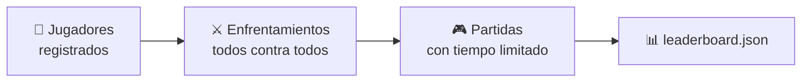

# El torneo

El torneo enfrenta a **todos los jugadores registrados** entre sí y escribe un
archivo de resultados que la [página web](web.md) renderiza como marcador.



Lo ejecutas tú con `blackhole-tournament`, y lo ejecuta una GitHub Action de
forma programada.

---

## Cómo se puntúa: por puntos

BlackHole [no es un juego de suma cero](../rules.md#no-es-un-juego-de-suma-cero):
en cada partida **los dos jugadores puntúan**, y cada uno intenta maximizar su
propia puntuación. Por eso el torneo no cuenta partidas ganadas, sino **puntos**:

```text
puntos de un jugador = suma de lo que puntuó en todas sus partidas
```

Quién superó a quién en cada partida (victorias, empates y derrotas) se sigue
registrando, pero **solo como información**: no decide la clasificación.

!!! example "Por qué no basta con ganar"
    Un jugador que gana todas sus partidas 1 a 0 suma menos puntos que otro que
    las pierde todas 5 a 6. En BlackHole lo que se premia es **puntuar mucho**,
    no quedar por encima del rival.

---

## Un «enfrentamiento» son muchas partidas

Dos jugadores no juegan una partida: juegan una **serie**. Para cada grafo
inicial, y con cada uno saliendo primero una vez, se juegan `--repetitions`
partidas.

```text
partidas de un enfrentamiento = nº de grafos × 2 × repeticiones
```

Con los valores por defecto (3 grafos, 3 repeticiones) son **18 partidas** por
pareja. Los tres grafos por defecto son deliberadamente distintos:

| Grafo | Nodos | *N* (turnos por jugador) | *M* (fichas por jugador) |
|---|---|---|---|
| `classic()` — el ejemplo de las [reglas](../rules.md) | 5 | 2 | 3 |
| `wheel(7)` — un centro unido a un anillo de 6 | 7 | 3 | 6 |
| `grid(3, 3)` — una cuadrícula de 3×3 | 9 | 4 | 10 |

!!! info "Por qué se alterna quién sale primero"
    En BlackHole salir primero o segundo cambia mucho la partida: por ejemplo,
    el segundo jugador hace la última jugada y elige cuál de los dos últimos
    nodos libres se convierte en el agujero negro. Si no se alternara, el
    torneo mediría el sorteo en vez de la habilidad.

---

## Los tres formatos

| Formato | Emparejamientos | Clasificación |
|---------|-----------------|---------------|
| `simple` *(por defecto)* | todos contra todos, cada par una vez | puntos |
| `league` | todos contra todos, cada par una vez | puntuación Elo |
| `championship` | fase de grupos + cuadro eliminatorio | puntos y un campeón |

Se elige con `--tournament`.

??? info "Detalle de `league` y `championship`"
    **`league`** usa el mismo todos contra todos que `simple`, pero ordena por
    una [puntuación Elo][blackholearena.elo] actualizada partida a partida
    (K=32, inicio 1500). El Elo trata cada partida **como si fuera de suma
    cero**: gana quien puntúa más (1), pierde quien puntúa menos (0) y, si
    puntúan lo mismo, es empate (0,5). El margen no cuenta: para eso están los
    puntos. `--no-elo` vuelve a puntos.

    El Elo se calcula y se publica **en todos los formatos**, aunque solo
    decide la clasificación en `league`.

    **`championship`** reparte a los jugadores en **grupos de cuatro**
    equilibrados; cada grupo juega un todos contra todos, se ordena por
    **puntos** y sus **dos primeros pasan** a un cuadro de eliminación directa
    con cabezas de serie (con exenciones para los mejores cuando el número no
    es potencia de dos). Cada eliminatoria es un enfrentamiento completo, y
    pasa **quien suma más puntos** en él; si empatan a puntos, pasa la mejor
    cabeza de serie.

??? info "Por qué un jugador puede aparecer como `random_0` y `random_1`"
    Un tipo de jugador puede inscribirse **más de una vez**, cada copia con su
    propia semilla, que es lo que permite que un tipo compita contra *sí mismo*
    — un todos contra todos nunca empareja una instancia consigo misma. Las
    copias se llaman `<tipo>_<semilla>`, y el marcador renderiza ese sufijo como
    subíndice.

    Los jugadores de referencia entran **dos** veces y los enviados por PR
    **una**, porque el lado de las propuestas crece con cada PR fusionado y el
    trabajo crece con el cuadrado de la plantilla. `--player-repetition` lo
    sobrescribe.

---

## Robustez: un mal bot nunca rompe la ejecución

Incluso los bots bienintencionados pueden colgarse, romperse o devolver una
jugada ilegal en algún caso límite. El torneo sobrevive a todo ello:

| Fallo | Se registra como |
|-------|------------------|
| supera su presupuesto de partida, o se cuelga | `forfeit_timeout` |
| lanza una excepción jugando | `forfeit_error` |
| devuelve una jugada ilegal o malformada | `forfeit_illegal` |
| `create()` supera el presupuesto | `forfeit_build_timeout` |
| `create()` lanza una excepción | `forfeit_build_error` |

Una descalificación corta la partida, así que no llega a haber agujero negro.
En su lugar, **el infractor puntúa 0** y **su rival puntúa el máximo** que se
puede conseguir en ese grafo, *M* (`tiles_per_player`): toparse con un bot roto
nunca perjudica al inocente. En todos los casos se registra el motivo y la
ejecución **continúa**.

---

## Los tiempos

Cada jugador recibe **dos presupuestos por partida**, no por jugada:

| Presupuesto | Por defecto | Cubre |
|---|---|---|
| de partida (`--game-time-limit`) | 2 s | todo tu tiempo de pensar en esa partida, acumulado |
| de construcción (`--build-time-limit`) | 2 s | `create()` |

Son acumulativos: un bot puede quemar casi todo su presupuesto en una posición
difícil y jugar el resto al instante. Están separados para que no se pueda colar
precálculo gratis en el constructor.

!!! warning "El tiempo se mide en CI"
    El torneo oficial se ejecuta en los **runners de GitHub**, más lentos y
    variables que un portátil. Un bot que pasa en tu máquina todavía puede
    agotar el tiempo allí. Es una regla declarada, no una sorpresa.

??? info "Cómo se cumple el límite de verdad"
    Cada **partida** se ejecuta en un proceso aparte. Si un bot se cuelga en un
    bucle infinito, el proceso se **termina** y el bot queda descalificado; el
    torneo sigue. Los hilos de Python no se pueden matar a la fuerza, así que un
    tiempo basado en hilos no podría garantizar esto.

    Se bifurca por partida y no por jugada a propósito: las cachés y la posición
    del generador aleatorio de un jugador tienen que sobrevivir de una jugada a
    la siguiente *dentro de su propia partida*.

    `--no-subprocess` da un modo de «tiempo blando» en un solo proceso para
    ejecuciones locales rápidas; sigue descalificando a quien se pase, pero no
    puede interrumpir un bucle infinito real.

---

## Ejecutarlo

```bash
# Lo habitual: torneo simple, escribe la clasificación
blackhole-tournament --out results/leaderboard.json

# Una liga ordenada por Elo
blackhole-tournament --tournament league

# Rápido, para probar tu bot mientras lo escribes
blackhole-tournament --no-subprocess

# Tus propios grafos: NODOS:A-B,C-D,... (repetible)
blackhole-tournament --graph 5:0-1,1-2,2-3,3-4,4-0
```

Las opciones que usarás casi siempre:

| Opción | Por defecto | Significado |
|--------|-------------|-------------|
| `--out` | `results/leaderboard.json` | dónde escribir el archivo de resultados |
| `--tournament` | `simple` | `simple`, `league` o `championship` |
| `--graph` | tres grafos | un grafo inicial, p. ej. `--graph 5:0-1,1-2,2-3,3-4,4-0`; repetible |
| `--no-subprocess` | off | tiempo blando en un solo proceso (rápido, local) |

El valor de `--graph` es el número de nodos (impar, al menos 3), dos puntos, y
las aristas `a-b` separadas por comas, con los nodos numerados desde `0`.

??? info "Todas las opciones"
    | Opción | Por defecto | Significado |
    |--------|-------------|-------------|
    | `--time-limit` | `2.0` | presupuesto por jugador en segundos, para una partida entera *y* para construir |
    | `--game-time-limit` | — | sobreescribe solo el presupuesto de pensar |
    | `--build-time-limit` | — | sobreescribe solo el de construcción |
    | `--no-time-limit` | off | no impone nada (nunca con jugadores no confiables) |
    | `--repetitions` | `3` | partidas por (grafo, quién sale primero) |
    | `--player-repetition` | *la de cada tipo* | sobrescribe las copias inscritas |
    | `--group-size` | `4` | solo campeonato: jugadores por grupo |
    | `--advance-per-group` | `2` | solo campeonato: cuántos pasan |
    | `--elo` / `--no-elo` | on | usar Elo para la clasificación de liga |
    | `--builtin-manifest` | `players/builtin/players.yaml` | manifiesto de la escalera de referencia |
    | `--custom-manifest` | `players/custom/players.yaml` | manifiesto de los jugadores enviados |

---

## Cómo se clasifica

`simple` y `championship` clasifican por **puntos** (la suma de lo puntuado en
todas las partidas); `league` clasifica por **Elo**. Los empates se rompen por
**menos descalificaciones** y luego por **nombre**, de modo que el orden es
completamente determinista.

Sea cual sea el formato, cada jugador se mide con **cuatro valores**, que son
los ejes del gráfico radar del marcador:

| Valor | Qué mide | Visión del juego |
|-------|----------|------------------|
| **puntos** | suma de lo puntuado en todas las partidas | real: no es de suma cero |
| **Elo** | quién gana a quién, partida a partida | como si fuera de suma cero |
| **% de victorias** | partidas en las que puntuó más que el rival | como si fuera de suma cero |
| **tiempo medio por jugada** | lo que tarda en decidir (menos es mejor) | — |

!!! note "El tiempo por jugada *no* desempata, a propósito"
    Premiaría lo que no toca: un jugador que queda descalificado en todas las
    partidas no registra ningún tiempo de jugada, así que ganaría cualquier
    desempate por velocidad. Por eso las descalificaciones van primero.

### La escalera de referencia

Con el proyecto vienen cinco jugadores, de menos a más elaborados:

```text
🎲 random  →  🌱 easy  →  ⚔️ aggressive-max · 🗡️ aggressive-min · 🤝 cooperative
```

| Jugador | Estrategia |
|---|---|
| 🎲 `random` | un nodo libre al azar. Es la **base**: un bot que no puntúa claramente más que `random` no tiene todavía una estrategia |
| 🌱 `easy` | una sola regla: un nodo libre al azar **que tenga algún vecino libre** (cualquiera si no hay ninguno). En la última jugada es exacta: si los dos nodos que quedan son vecinos, el que se juega toca al agujero negro y se lleva el lote de fichas más grande de la partida |
| ⚔️ `aggressive-max` | búsqueda que maximiza **su propia** puntuación, suponiendo que el rival intenta bajársela |
| 🗡️ `aggressive-min` | búsqueda que minimiza **la puntuación del rival**, suponiendo que el rival intenta subirla. Nunca cuenta sus propios puntos |
| 🤝 `cooperative` | búsqueda que maximiza **la suma** de las dos puntuaciones, suponiendo que el rival colabora |

Los tres últimos son el mismo motor de búsqueda y solo se diferencian en lo que
quieren; cómo funciona se explica [más abajo](#como-juegan-los-jugadores-de-busqueda).

Cada uno entra dos veces, como `random_0` y `random_1`, `easy_0` y `easy_1`,
etc. Cuál de las dos copias queda por delante depende solo del sorteo; si
intercambian posiciones entre ejecuciones, no pasa nada.

!!! example "Qué da de sí cada uno"
    Medido en una liga (`--tournament league`, los tres grafos por defecto, 3
    repeticiones, dos copias de cada jugador), en media por partida:

    | Jugador | Puntos por partida | Elo | % de victorias |
    |---|---|---|---|
    | ⚔️ `aggressive-max` | ≈ 3,7 | ≈ 1570 | ≈ 50 % |
    | 🗡️ `aggressive-min` | ≈ 3,1 | ≈ 1790 | ≈ 70 % |
    | 🌱 `easy` | ≈ 2,8 | | |
    | 🎲 `random` | ≈ 2,6 | | |
    | 🤝 `cooperative` | ≈ 2,4 | ≈ 1270 | ≈ 7 % |

    `aggressive-max` es el que **más puntúa**, pero `aggressive-min` tiene el
    **mejor Elo y el mejor % de victorias**: gana negándole puntos al rival, no
    sumándolos. `cooperative` queda último: los rivales egoístas se aprovechan
    de los puntos que les prepara. Ninguno roza el límite de tiempo: una
    partida entera les lleva bastante menos de 0,5 s, incluso en grafos de 13
    nodos.

    Son medidas aproximadas de una ejecución, no garantías: cambian con los
    grafos, las semillas y el número de repeticiones.

!!! note "En `league`, los puntos y el puesto pueden discrepar"
    El puesto viene del Elo mientras la tabla también muestra puntos, así que un
    jugador con más puntos puede quedar *por debajo* de otro con menos. Eso es
    el Elo funcionando como debe: pondera *contra quién* puntúas, no solo
    cuánto. La propia escalera lo ilustra: en `league`, `aggressive-min` queda
    por encima de `aggressive-max` aunque suma menos puntos.

---

## Cómo juegan los jugadores de búsqueda

`aggressive-max`, `aggressive-min` y `cooperative` son la misma búsqueda en el
árbol de la partida, [`SearchBot`][blackholearena.bots.search.SearchBot], con
dos ajustes distintos. Como BlackHole
[no es de suma cero](../rules.md#no-es-un-juego-de-suma-cero), «la mejor jugada»
depende de dos decisiones que el minimax clásico esconde: **qué valora el bot**
al final de la partida, dadas las dos puntuaciones `(mía, suya)`, y **cómo
supone que juega el rival**.

| Jugador | Utilidad que maximiza | Modelo del rival |
|---|---|---|
| ⚔️ `aggressive-max` | `mía` | adversario: minimiza esa utilidad |
| 🗡️ `aggressive-min` | `-suya` | adversario: minimiza esa utilidad, es decir, maximiza su propia puntuación |
| 🤝 `cooperative` | `mía + suya` | colaborador: maximiza esa misma utilidad |

En un juego de suma cero los dos agresivos jugarían igual. En BlackHole no: una
jugada puede ser buena para los dos, o mala para los dos.

**Profundidad según un presupuesto.** Desde una posición con *F* nodos libres
hay *F* jugadas, luego *F* − 1, etc., así que un árbol completo de profundidad
*d* tiene *F* + *F*(*F* − 1) + … nodos. Antes de cada jugada el bot elige la
**mayor profundidad uniforme cuyo árbol completo cabe en su presupuesto**
(`search_depth`; por defecto 30 000 nodos por jugada, `DEFAULT_MAX_NODES`), sin
pasar del final de la partida. Todas las ramas se buscan hasta esa misma
profundidad: al principio el árbol es ancho y la búsqueda poco profunda; cerca
del final llega a las posiciones finales y juega de forma exacta.

**Una heurística en el límite.** Donde la búsqueda se corta, `expected_scores`
estima las dos puntuaciones finales sin suponer nada sobre cómo se jugará: cada
ficha ya colocada cuenta en proporción a cuántos vecinos libres tiene su nodo
(el agujero será uno de los nodos libres, cualquiera por igual), y cada ficha
que falta por colocar puntúa con la probabilidad de que dos nodos libres al azar
sean vecinos. La estimación pasa por la misma utilidad que una puntuación real.

**Poda alfa-beta.** Vale para los tres, porque cada uno se reduce a «un lado
maximiza un número y el otro lo maximiza o lo minimiza». La ventana empieza en
las cotas reales de la utilidad, así que una rama que ya alcanza el mejor valor
posible corta la búsqueda en el acto; es el único corte que tiene
`cooperative`, en cuyo árbol todos los nodos maximizan.

**Memoización, solo de lo exacto.** Una tabla de transposición guarda
**únicamente** las posiciones cuyo subárbol se buscó **hasta el final de la
partida**: ese valor es el real (o una cota real), así que se puede reutilizar
sin riesgo. Un valor que se apoya en hojas heurísticas **no** se guarda, porque
depende de hasta dónde llegó esa búsqueda concreta. Con una profundidad
uniforme, una búsqueda llega al final en todas sus ramas o en ninguna, de modo
que la tabla se llena en el final de la partida y hace que los turnos
siguientes salgan casi gratis. Dentro de una misma búsqueda no se repite
ninguna posición: el número de fichas de un nodo *es* el turno en que se jugó,
así que cada posición lleva su propia historia. La tabla rinde *entre turnos*.

!!! tip "Míralo pensar"
    En la [página web](web.md), el registro de jugadas muestra, para cada
    jugada de estos bots, la profundidad buscada, el valor encontrado y los
    nodos visitados.

---

**Siguiente:** [El marcador](scoreboard.md) — qué escribe el torneo y cómo se
convierte en la tabla que ves.
