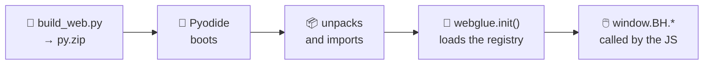

# The web app

The [live page](https://jparisu.github.io/blackhole-arena) is a **static site**
served by GitHub Pages. It loads [Pyodide](https://pyodide.org) (Python compiled
to WebAssembly) and runs **the same** game engine and the same AI players in
your browser.

!!! quote "One source of truth"
    The rules and the AIs come from the shared Python, executed through Pyodide.
    The rules are **never** re-implemented in JavaScript. The JavaScript job is
    deliberately thin: draw the graph, handle clicks, animate, and drive the
    timeline.

---

## How it loads

1. `scripts/build_web.py` bundles the library, the whole `players/` tree and the
   `webglue.py` bridge into `web/py.zip`.
2. In the browser, `bootArena()` (in `pyodide-bootstrap.js`) boots Pyodide,
   loads PyYAML, downloads `py.zip`, unpacks it into Pyodide's virtual
   filesystem and imports `webglue`.
3. `webglue.init()` loads the manifest and fills the registry.
4. The page scripts call the bridge (`window.BH.*`) for every rule check and
   every AI move.

Everything crosses the Python↔JS boundary as **JSON strings**: state is the
`{"edges", "owner", "tiles"}` dict and a move is a node index. No custom
objects.

---

## What you can do on it

| | Feature | What it does |
|---|---|---|
| 🕸️ | **Configurable graph** | pick a preset graph (the `PRESETS` from `blackholearena.graphs`) or a random graph, the number of nodes, and edit the edge list |
| 👥 | **Pick each seat** | human or any registered AI |
| 🖱️ | **Play by clicking** | the human places its tiles by clicking a free node of the graph |
| 🎨 | **The graph, in SVG** | every taken node shows its player's colour and its tile count; at the end the black hole and its neighbours are highlighted and the scores are shown |
| 🔍 | **X-ray mode** | shows, on every free node, what each player would score if that node became the black hole |
| 📜 | **Move log** | who placed how many tiles on which node, move by move |
| ⏪ | **Replay and time travel** | step through the timeline move by move, and jump back to live |
| 🏆 | **Tournament page** | an in-browser single-elimination bracket |
| 🔗 | **Shareable game** | the game is encoded in the URL: share a link and it replays |

!!! info "X-ray mode is not a bot"
    It does not tell you which move is best: it only applies `scores_if_hole`
    to every free node, counting the tiles already on the board. Reading it —
    and anticipating what the opponent will do — is still up to you.

---

## The tournament screen

It builds a **single-elimination bracket** in the browser: you pick the entrants
and a preset graph, and every match is decided by **one game** on that graph.
Whoever **scores more points** advances; on a tie, the upper entrant of the
bracket goes through.

It has nothing to do with the [official tournament](tournament.md): there are no
series of games, no time budgets, and no results are written.

---

## What the page does *not* do

| There is no… | Why |
|---|---|
| **time limit** | live play is best-effort; timing and forfeits belong to the [tournament](tournament.md), which runs in CI |
| **backend, secrets or paid services** | everything is static, plus Pyodide, plus one downloaded JSON file |
| **“run the tournament” button** | triggering it from a static page would mean exposing a token in the browser. Use GitHub's own “Run workflow” UI |

---

## The scoreboard screen

It downloads `leaderboard.json` (copied next to the page by the build) and
renders the **points-based** ranking produced entirely by the tournament
workflow. No game is played to draw it: it is pure data rendering.

---

**Next:** [The scoreboard](scoreboard.md) — the structure of the file it reads.
