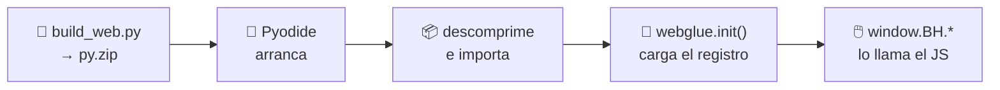

# La página web

La [página en vivo](https://jparisu.github.io/blackhole-arena) es un **sitio
estático** servido por GitHub Pages. Carga [Pyodide](https://pyodide.org)
(Python compilado a WebAssembly) y ejecuta **el mismo** motor de juego y los
mismos jugadores de IA en tu navegador.

!!! quote "Una única fuente de verdad"
    Las reglas y las IA vienen del Python compartido, ejecutado con Pyodide. Las
    reglas **nunca** se reimplementan en JavaScript. El trabajo de JavaScript es
    deliberadamente fino: dibujar el grafo, gestionar los clics, animar y
    llevar la línea temporal.

---

## Cómo carga

1. `scripts/build_web.py` empaqueta la librería, todo el árbol `players/` y el
   puente `webglue.py` en `web/py.zip`.
2. En el navegador, `bootArena()` (en `pyodide-bootstrap.js`) arranca Pyodide,
   carga PyYAML, descarga `py.zip`, lo descomprime en el sistema de archivos
   virtual de Pyodide e importa `webglue`.
3. `webglue.init()` carga el manifiesto y rellena el registro.
4. Los scripts de la página llaman al puente (`window.BH.*`) para cada
   comprobación de reglas y cada jugada de la IA.

Todo cruza la frontera Python↔JS como **cadenas JSON**: el estado es el
diccionario `{"edges", "owner", "tiles"}` y una jugada es el índice de un nodo.
Nada de objetos propios.

---

## Qué puedes hacer en ella

| | Funcionalidad | Qué hace |
|---|---|---|
| 🕸️ | **Grafo configurable** | elige un grafo predefinido (los `PRESETS` de `blackholearena.graphs`) o un grafo aleatorio, el número de nodos, y edita la lista de aristas |
| 👥 | **Elige cada asiento** | humano o cualquier IA registrada |
| 🖱️ | **Juega con clics** | el humano coloca sus fichas pulsando un nodo libre del grafo |
| 🎨 | **El grafo, en SVG** | cada nodo ocupado lleva el color de su jugador y su número de fichas; al final se resaltan el agujero negro y sus vecinos, y se muestran las puntuaciones |
| 🔍 | **Modo rayos X** | muestra, sobre cada nodo libre, cuánto puntuaría cada jugador si ese nodo se convirtiera en el agujero negro |
| 📜 | **Registro de jugadas** | quién colocó cuántas fichas en qué nodo, jugada a jugada |
| ⏪ | **Repetición y viaje en el tiempo** | recorre la línea temporal jugada a jugada y vuelve al estado en vivo |
| 🏆 | **Página de torneo** | un cuadro de eliminación directa en el navegador |
| 🔗 | **Partida compartible** | la partida se codifica en la URL: compartes un enlace y se repite |

!!! info "El modo rayos X no es un bot"
    No dice qué jugada es la mejor: solo aplica `scores_if_hole` a cada nodo
    libre, contando las fichas que ya están colocadas. Interpretarlo —y
    anticipar lo que hará el rival— sigue siendo cosa tuya.

---

## La pantalla de torneo

Construye en el navegador un **cuadro de eliminación directa**: eliges los
participantes y un grafo predefinido, y cada eliminatoria se decide con **una
partida** sobre ese grafo. Pasa quien **suma más puntos**; si empatan, pasa el
participante de arriba del cuadro.

No tiene nada que ver con el [torneo oficial](tournament.md): no hay series de
partidas, ni presupuestos de tiempo, ni se escribe ningún resultado.

---

## Lo que la página *no* hace

| No hay… | Por qué |
|---|---|
| **tiempos límite** | el juego en vivo es de mejor esfuerzo; los tiempos y las descalificaciones pertenecen al [torneo](tournament.md), que se ejecuta en CI |
| **backend, secretos ni servicios de pago** | todo es estático, más Pyodide, más un archivo JSON descargado |
| **botón de «ejecutar el torneo»** | dispararlo desde una página estática exigiría exponer un token en el navegador. Usa la interfaz «Run workflow» de GitHub |

---

## La pantalla del marcador

Descarga `leaderboard.json` (copiado junto a la página por la construcción) y
renderiza la clasificación **por puntos** producida enteramente por el workflow
del torneo. No se juega ninguna partida para dibujarla: es renderizado puro de
datos.

---

**Siguiente:** [El marcador](scoreboard.md) — la estructura del archivo que lee.
