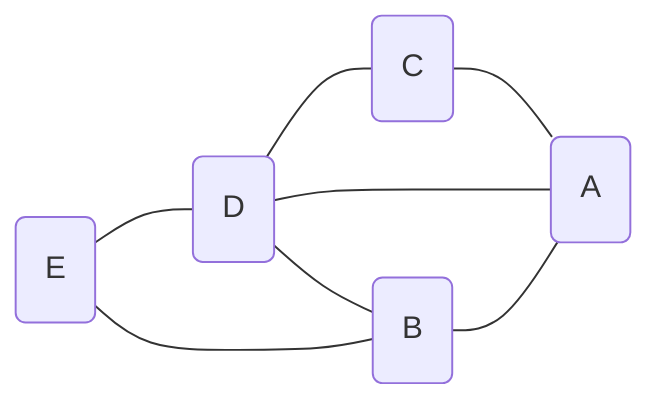
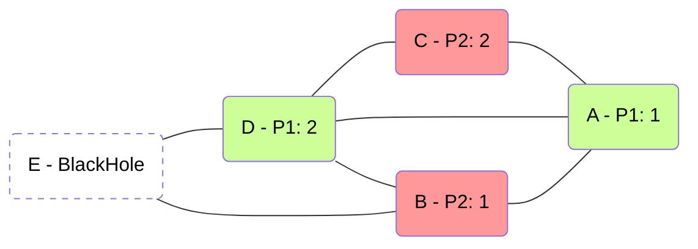

# Game rules

**BlackHole** is a two-player, turn-based game played on a **graph**: a set of
nodes joined by edges.

- Each player has *N* turns to place *M = N(N+1)/2* tiles on a graph of
  *2N + 1* nodes.
- On its turn *n*, a player places *n* tiles on **one free node** of the graph.
- When the game ends one node is still free: that node is the ***BlackHole***.
- Each player scores as many points as tiles it placed on the nodes
  **adjacent** to the *BlackHole*.

**Each player's goal is to maximize its own final score.**

---

## How it is played

Players alternate, always starting with the same one. On each turn, the player
to move:

- chooses **one free node** (one nobody has taken yet), and
- places on it **as many tiles as turns it has had**, this one included: 1 tile
  on its first turn, 2 on its second… and *N* on its last.

An occupied node never changes: it belongs to whoever took it, with its tiles,
until the end of the game.

| Turn of the game | Who plays | Tiles placed |
|---|---|---|
| 1 | player 1 | 1 |
| 2 | player 2 | 1 |
| 3 | player 1 | 2 |
| 4 | player 2 | 2 |
| … | … | … |
| *2N - 1* | player 1 | *N* |
| *2N* | player 2 | *N* |

After *2N* turns, *2N* of the *2N + 1* nodes are taken, so **exactly one node
is left free**: that is the *BlackHole*, and the game is over.

---

## A complete example

Here is an example game of BlackHole with *N = 2* (*M = 3*), on the following
5-node graph:



The game takes 4 turns (2 per player):

1. On the first turn, player 1 (green) must place 1 tile on a free node. For
   example, on node *A*.
1. Now it is player 2's turn (red). It must place 1 tile on a free node. For
   example, on node *B*.
1. It is player 1's turn again, and it must place 2 tiles on a free node. For
   example, on node *D*.
1. Finally, player 2 must place 2 tiles on a free node. For example, on node
   *C*.

After these 4 turns the game is over, and this is the final position:



The free node is *E*, which becomes the *BlackHole*. The nodes next to *E* are
*B* and *D*: those are the scoring nodes.

- **Player 1 placed 2 tiles on node *D*, so it scores 2 points.**
- **Player 2 placed 1 tile on node *B*, so it scores 1 point.**

The tiles on *A* and *C* do not score: those nodes do not touch the
*BlackHole*.

---

## In the code

In the `blackholearena` library nodes are numbered from `0`, and the players
are `0` (the one who moves first, "player 1" above) and `1` (the second one).

| Concept | How it is represented | Example |
|---|---|---|
| **Graph** | list of `[a, b]` edges | `[[0, 1], [2, 3], [3, 4], …]` |
| **State** | dict `{"edges", "owner", "tiles"}` | see below |
| **Move** | an `int`: the free node to place the tiles on | `3` |
| **End** | a single free node is left | `owner` with a single `None` |

The state is a plain Python dict, with no custom objects:

- `edges`: the edges of the graph, which never change.
- `owner[v]`: `0` or `1` if node `v` is taken by that player, or `None` if it
  is free.
- `tiles[v]`: how many tiles are on node `v` (`0` if it is free).

A move is **just the node**: how many tiles are placed, and by whom, is not part
of the move, because both follow from the state itself. That way a state can
never contradict itself.

!!! example "The example above, in Python"
    The graph of the example ships as `graphs.classic()`, with nodes `A..E`
    numbered `0..4`:

    ```python
    from blackholearena import game, graphs

    state = graphs.classic()            # every node free
    for node in [0, 1, 3, 2]:           # A, B, D, C
        print(game.to_move(state), "places", game.tiles_to_place(state), "on", node)
        state = game.apply_move(state, node)

    print(state["owner"])               # [0, 1, 1, 0, None]
    print(state["tiles"])               # [1, 1, 2, 2, 0]
    print(game.black_hole(state))       # 4  (node E)
    print(game.scores(state))           # (2, 1)
    ```

The functions of `blackholearena.game` you will use the most:

| Function | Returns |
|---|---|
| `to_move(state)` | the player to move: `0` or `1` |
| `tiles_to_place(state)` | how many tiles the current move places |
| `legal_moves(state)` | the free nodes (empty once the game is over) |
| `apply_move(state, node)` | a **new** state with the move applied |
| `is_terminal(state)` | `True` if only one free node is left |
| `black_hole(state)` | the *BlackHole* of a finished game |
| `scores(state)` | the final points `(player 0, player 1)` |
| `scores_if_hole(state, node)` | the points *if* `node` were the *BlackHole* right now |

A state is **a plain dict of lists and ints and nothing more**. This is a hard
requirement: that *same* representation crosses from Python (the tournament) to
JavaScript (the rendering) and back into Python (Pyodide, in the browser). No
custom objects at the boundary.

!!! note "Configurable graphs"
    Both the web page and the tournament let you choose the graph. The
    tournament defaults to three: the graph of the example (`classic`, 5
    nodes), a 7-node wheel (`wheel(7)`) and a 3×3 grid (`grid(3, 3)`). Any graph
    with an **odd** number of nodes, at least 3, is valid.

---

## It is not a zero-sum game

In many games, what one player wins the other loses. Not in BlackHole: both
players score in every game, and what one gets is not taken from the other.
Both can score well, both badly, or one well and the other badly. The example
ends 2 to 1, but other moves could have ended it 2 to 2, or 0 to 0.

That changes how a player is measured in the
[tournament](advanced/tournament.md):

- The ranking is by **points**: the sum of what a player scored over **all**
  its games. Not by games won.
- Who outscored whom in each game (wins, draws and losses) is recorded, but
  **only as information**.
- Hurting your opponent does not give you points by itself. It only matters as
  far as it helps you score more.

---

## Some ideas to think about

There is no known winning strategy you can copy, but there are a few
observations that will help you design your bot:

- **The last tiles weigh the most.** Your last turn places *N* tiles; your
  first, a single one. Where you put the big stacks matters far more.
- **The second player picks the *BlackHole*.** The last move of the game
  belongs to player 2, when two free nodes are left: the one it takes keeps its
  tiles, and the other one becomes the *BlackHole*.
- **Well-connected nodes cut both ways.** They touch more *BlackHole*
  candidates, but they are good *BlackHole* candidates themselves — and once you
  take one, it can no longer be the hole.

!!! tip "See it live"
    **X-ray mode** on the [web app](advanced/web.md) shows, on every free node,
    how much each player would score if that node ended up as the *BlackHole*.
    That is exactly what `scores_if_hole` computes.

---

**Next:** [Getting started](advanced/getting-started.md) — install the package
and play a game. Or go straight to the
[Player API](upload-a-bot/player-api.md) to turn these ideas into code.
