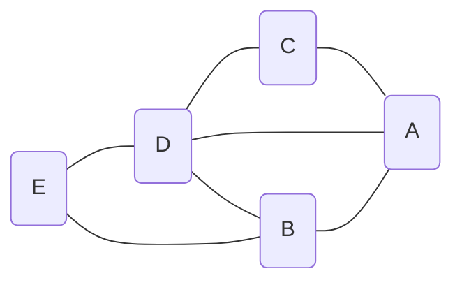
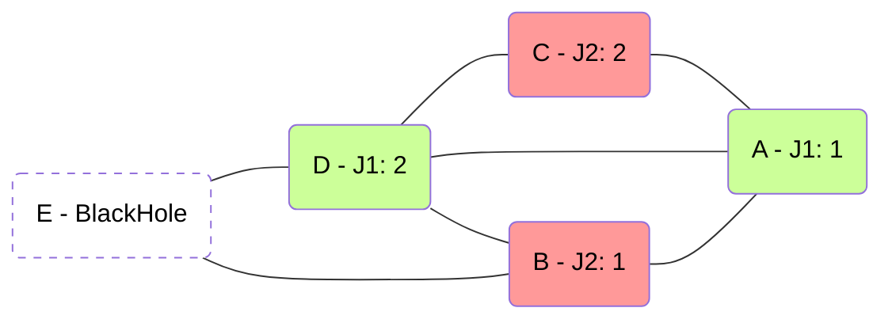

# Reglas del juego

**BlackHole** es un juego de 2 jugadores por turnos que se juega sobre un
**grafo**: unos nodos unidos por aristas.

- Cada jugador cuenta con *N* turnos para colocar *M = N(N+1)/2* fichas
  en un grafo de *2N + 1* nodos.
- En su turno *n*, el jugador coloca *n* fichas en **un nodo libre** del grafo.
- Al finalizar el juego queda un nodo libre, que será el ***BlackHole*** (el
  agujero negro).
- Cada jugador gana tantos puntos como fichas haya colocado en los nodos
  **adyacentes** al *BlackHole*.

**El objetivo de cada jugador es maximizar su propia puntuación final.**

---

## Cómo se juega

Los jugadores se alternan, empezando siempre por el mismo. En cada turno, el
jugador al que le toca:

- elige **un nodo libre** (que nadie haya ocupado todavía), y
- coloca en él **tantas fichas como turnos lleva** contando este: 1 ficha en su
  primer turno, 2 en el segundo… y *N* en el último.

Un nodo ocupado ya no cambia: pertenece a quien lo ocupó, con sus fichas, hasta
el final de la partida.

| Turno de la partida | Juega | Fichas que coloca |
|---|---|---|
| 1 | jugador 1 | 1 |
| 2 | jugador 2 | 1 |
| 3 | jugador 1 | 2 |
| 4 | jugador 2 | 2 |
| … | … | … |
| *2N - 1* | jugador 1 | *N* |
| *2N* | jugador 2 | *N* |

Tras *2N* turnos se han ocupado *2N* de los *2N + 1* nodos, así que queda
**exactamente un nodo libre**: ese es el *BlackHole*, y la partida termina.

---

## Un ejemplo completo

Vamos a mostrar un ejemplo de una partida de BlackHole con *N = 2* (*M = 3*),
sobre el siguiente grafo de 5 nodos:



La partida se desarrolla en 4 turnos (2 por jugador):

1. En el primer turno, el jugador 1 (verde) debe colocar 1 ficha en un nodo
   libre. Por ejemplo, en el nodo *A*.
1. Ahora es el turno del jugador 2 (rojo). Este debe colocar 1 ficha en un nodo
   libre. Por ejemplo, en el nodo *B*.
1. Es el siguiente turno del jugador 1, que debe colocar 2 fichas en un nodo
   libre. Por ejemplo, en el nodo *D*.
1. Por último, el jugador 2 debe colocar 2 fichas en un nodo libre. Por
   ejemplo, en el nodo *C*.

Tras estos 4 turnos, el juego ha acabado, quedando la siguiente posición final:



El nodo libre ha sido el nodo *E*, que se convierte en el *BlackHole*. Los
nodos contiguos a *E* son *B* y *D*, que son las casillas premiadas.

- **El jugador 1 ha colocado 2 fichas en el nodo *D*, por lo que obtiene 2
  puntos.**
- **El jugador 2 ha colocado 1 ficha en el nodo *B*, por lo que obtiene 1
  punto.**

Las fichas de *A* y *C* no puntúan: esos nodos no tocan el *BlackHole*.

---

## En el código

En la librería `blackholearena`, los nodos se numeran desde `0` y los jugadores
son `0` (el que sale primero, el «jugador 1» de arriba) y `1` (el segundo).

| Concepto | Cómo se representa | Ejemplo |
|---|---|---|
| **Grafo** | lista de aristas `[a, b]` | `[[0, 1], [2, 3], [3, 4], …]` |
| **Estado** | diccionario `{"edges", "owner", "tiles"}` | ver abajo |
| **Jugada** | un `int`: el nodo libre donde colocar las fichas | `3` |
| **Final** | queda un solo nodo libre | `owner` con un único `None` |

El estado es un diccionario de Python normal, sin objetos propios:

- `edges`: las aristas del grafo, que nunca cambian.
- `owner[v]`: `0` o `1` si el nodo `v` está ocupado por ese jugador, o `None`
  si está libre.
- `tiles[v]`: cuántas fichas hay en el nodo `v` (`0` si está libre).

Una jugada es **solo el nodo**: cuántas fichas se colocan y quién las coloca no
forman parte de la jugada, porque se deducen del propio estado. Así un estado
nunca puede contradecirse a sí mismo.

!!! example "El ejemplo de arriba, en Python"
    El grafo del ejemplo viene incluido como `graphs.classic()`, con los nodos
    `A..E` numerados `0..4`:

    ```python
    from blackholearena import game, graphs

    state = graphs.classic()            # todos los nodos libres
    for node in [0, 1, 3, 2]:           # A, B, D, C
        print(game.to_move(state), "coloca", game.tiles_to_place(state), "en", node)
        state = game.apply_move(state, node)

    print(state["owner"])               # [0, 1, 1, 0, None]
    print(state["tiles"])               # [1, 1, 2, 2, 0]
    print(game.black_hole(state))       # 4  (el nodo E)
    print(game.scores(state))           # (2, 1)
    ```

Las funciones de `blackholearena.game` que más vas a usar:

| Función | Devuelve |
|---|---|
| `to_move(state)` | el jugador al que le toca: `0` o `1` |
| `tiles_to_place(state)` | cuántas fichas coloca la jugada actual |
| `legal_moves(state)` | los nodos libres (vacía si la partida ha terminado) |
| `apply_move(state, node)` | un estado **nuevo** con la jugada aplicada |
| `is_terminal(state)` | `True` si solo queda un nodo libre |
| `black_hole(state)` | el *BlackHole* de una partida terminada |
| `scores(state)` | los puntos finales `(jugador 0, jugador 1)` |
| `scores_if_hole(state, node)` | los puntos *si* `node` fuera el *BlackHole* ahora mismo |

Un estado es **un diccionario simple de listas y enteros, y nada más**. Es un
requisito firme: ese *mismo* valor cruza de Python (el torneo) a JavaScript (el
dibujo) y vuelve a Python (Pyodide, en el navegador). Ningún objeto propio en
la frontera.

!!! note "Grafos configurables"
    Tanto la página web como el torneo permiten elegir el grafo. El torneo usa
    por defecto tres: el grafo del ejemplo (`classic`, 5 nodos), una rueda de 7
    nodos (`wheel(7)`) y una cuadrícula de 3×3 (`grid(3, 3)`). Cualquier grafo
    con un número **impar** de nodos, al menos 3, es válido.

---

## No es un juego de suma cero

En muchos juegos lo que gana uno lo pierde el otro. En BlackHole **no**: los dos
jugadores puntúan en cada partida, y lo que consigue uno no se le resta al otro.
Pueden puntuar bien los dos, mal los dos, o uno sí y otro no. En el ejemplo
acaba 2 a 1, pero con otras jugadas podría haber acabado 2 a 2, o 0 a 0.

Eso cambia cómo se mide a un jugador en el [torneo](advanced/tournament.md):

- La clasificación se hace por **puntos**: la suma de lo que ha puntuado un
  jugador en **todas** sus partidas. No por partidas ganadas.
- Quién superó a quién en cada partida (victorias, empates y derrotas) se
  registra, pero **solo como información**.
- Perjudicar al rival no te da puntos por sí mismo. Solo te interesa en la
  medida en que te ayude a puntuar más tú.

---

## Algunas ideas para pensar

No hay una estrategia ganadora conocida que puedas copiar, pero sí algunas
observaciones que te ayudarán a diseñar tu bot:

- **Las últimas fichas pesan más.** Tu último turno coloca *N* fichas; el
  primero, solo una. Dónde pones las fichas grandes importa mucho más.
- **El segundo jugador decide el *BlackHole*.** La última jugada de la partida
  es del jugador 2, cuando quedan dos nodos libres: el que elija se queda con sus
  fichas y el otro se convierte en el *BlackHole*.
- **Los nodos con muchos vecinos son arma de doble filo.** Tocan a más
  candidatos a *BlackHole*, pero también son buenos candidatos a *BlackHole*
  ellos mismos, y si lo ocupas ya no puede serlo.

!!! tip "Míralo en vivo"
    El **modo rayos X** de la [página web](advanced/web.md) muestra, sobre cada
    nodo libre, cuánto puntuaría cada jugador si ese nodo acabara siendo el
    *BlackHole*. Es exactamente lo que calcula `scores_if_hole`.

---

**Siguiente:** [Primeros pasos](advanced/getting-started.md) — instala el
paquete y juega una partida. O ve directo a la
[API de jugador](upload-a-bot/player-api.md) para convertir estas ideas en
código.
