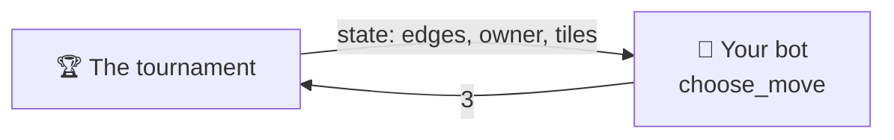

# Player API

To create your own BlackHole player for this repository, all you have to do is implement the `Player` class.
This class gives you one method that decides the move, and that will be your player's strategy.
This page helps you write your own bot from scratch.

---

## Start by copying this

A small, correct player: always place the tiles on the free node with the
**most neighbours**. Copy it, rename it, and you have a valid bot.

```python
from blackholearena.game import Move, State, adjacency, legal_moves
from blackholearena.player import Player


class HubBot(Player):
    @classmethod
    def get_name(cls) -> str:
        return "HubBot"

    @classmethod
    def get_authors(cls) -> list[str]:
        return ["your name"]

    @classmethod
    def get_description(cls) -> str:
        return "Places its tiles on the free node with the most neighbours."

    @classmethod
    def get_icon(cls) -> str:
        return "🧲"

    def choose_move(self, state: State) -> Move:
        adj = adjacency(state)  # adj[v] = the neighbours of node v
        return max(legal_moves(state), key=lambda node: len(adj[node]))
```

That bot plays legal games from start to finish. It usually scores a little
more than `random`, but it is easy to exploit: it never looks at whose tiles are
where, or how many it is placing. Still, it **competes**. From here on you only
change `choose_move`.

---

## What you just implemented



Five methods: four say **who you are**, one **plays**.

| Method | Returns | What it is |
|---|---|---|
| `get_name()` | `str` | your name, **unique** across all admitted players |
| `get_authors()` | `list[str]` | a non-empty list of names |
| `get_description()` | `str` | one or two sentences about your *strategy* |
| `get_icon()` | `str` | **one** emoji, shown next to your name |
| `choose_move(state)` | `int` | the decision: the free node to place your tiles on |

The first four are `@classmethod` because the tournament, the web app and the
docs need to label a player **without constructing one**.

!!! note "Python will not let you forget one"
    All five are abstract, so an incomplete subclass fails to instantiate, with a
    message naming the one you missed:

    ```text
    TypeError: Can't instantiate abstract class MyBot without an
               implementation for abstract method 'get_name'
    ```

!!! tip "Keep the icon to a single glyph"
    It renders in places that cannot handle markup (the scoreboard, a native
    `<select>`), and a two-glyph sequence breaks table alignment. The shipped
    players use, for example, 🎲 `random`, 🌱 `easy` and 🤝 `cooperative`.

---

## The exact types

### What you receive: `state`

A **dict** holding the graph and what is on each node:

```python
state = {
    "edges": [[0, 1], [2, 3], [3, 4], [0, 2], [0, 3], [1, 3], [1, 4]],
    "owner": [0, 1, None, None, None],   # node 0 → player 0, node 1 → player 1
    "tiles": [1, 1, 0, 0, 0],            # one tile on each
}
```

| Fact | Rule |
|---|---|
| Type | `dict` with three keys: `edges`, `owner`, `tiles` |
| `len(state["owner"])` | number of nodes, *2N + 1*, numbered from **0** |
| `state["edges"]` | the `[a, b]` edges of the graph; they never change during a game |
| `state["owner"][v]` | `0`, `1` or `None` (free node) |
| `state["tiles"][v]` | tiles on node `v` (`0` if it is free) |
| Finished game | you **never** receive one: there is always at least one move |

It is **read-only**: do not modify it. To explore the future, use `apply_move`,
which returns a new state.

### What you return: the move

An **`int`**: the index of the free node you place your tiles on.

```python
return 3              # place this turn's tiles on node 3
```

You do not say how many tiles: the turn fixes that (see `tiles_to_place`
below). A move is **legal** exactly when:

```text
0 <= node < len(state["owner"])   AND   state["owner"][node] is None
```

The single source of truth is `blackholearena.game.is_legal`. Return a real
`int`: booleans, tuples, strings and occupied nodes are all rejected.

---

## Tools for writing your bot

Your bot can import pure functions from `blackholearena.game`. You do not have
to reimplement any of these:

| Function | What for |
|---|---|
| `legal_moves(state)` | the free nodes you may play on |
| `is_legal(state, move)` | check a move |
| `apply_move(state, move)` | a **new** state with the move applied (no mutation) |
| `is_terminal(state)` | `True` if the game is over |
| `adjacency(state)` | `adj[v]`: the list of neighbours of every node |
| `neighbors(state, v)` | the neighbours of a single node |
| `free_nodes(state)` | the free nodes, also on a finished state |
| `to_move(state)` | **who you are**: `0` if you moved first, `1` if second |
| `tiles_to_place(state)` | **how many tiles** this move places |
| `turns_per_player(state)` / `tiles_per_player(state)` | *N* and *M* for the current graph |
| `scores_if_hole(state, node)` | **what each player would score** if `node` were the black hole right now |

Three of them are what turn an idea into a strategy:

- **`to_move`** tells you which player you are. You need it to read `owner`
  (which nodes are *yours*) and to pick *your* half of a score.
- **`tiles_to_place`** tells you what the current move is worth: 1 tile on your
  first turn, *N* on your last. A small move can "reserve" a node; a big one is
  what decides your score.
- **`scores_if_hole`** answers "how much would each of us score if the game
  ended here, with this node as the black hole?", counting only the tiles
  already placed. It is the natural base for a heuristic, and it is what the
  X-ray mode of the [web app](../advanced/web.md) shows.

!!! example "A one-move heuristic"
    For every possible move, look at how much you would score on average,
    depending on which of the still-free nodes ends up as the black hole:

    ```python
    from blackholearena.game import (apply_move, free_nodes, legal_moves,
                                     scores_if_hole, to_move)

    me = to_move(state)

    def average_score(node: int) -> float:
        after = apply_move(state, node)
        holes = free_nodes(after)
        return sum(scores_if_hole(after, h)[me] for h in holes) / len(holes)

    best = max(legal_moves(state), key=average_score)
    ```

    It ignores what the opponent will do next, so it is only a starting point.

!!! tip "Compute the adjacency once per move"
    `adjacency(state)` walks every edge. If your bot explores many positions,
    call it once at the start of `choose_move` instead of calling `neighbors`
    in a loop: the graph never changes during a game.

---

## The rules of the environment

The contract is tiny, but the tournament that calls your bot has rules of its
own. None of them appear in a method signature, so they are easy to forget.

### You get a time budget per game

**2 seconds for the whole game**, not per move. It is cumulative: you can burn
1.5 s on a hard position and play the rest instantly. There is a separate 2 s
budget for constructing your player.

!!! warning "Timing is measured on GitHub runners"
    They are slower and more variable than your laptop. A bot that fits the
    budget locally can still time out in the official run. Write efficient code.

### Every failure costs that game, never the run

| What you did | Recorded as |
|---|---|
| Went over your game budget, or hung | `forfeit_timeout` |
| Raised an exception while choosing a move | `forfeit_error` |
| Returned something that is not a free node | `forfeit_illegal` |
| Went over the budget while being constructed | `forfeit_build_timeout` |
| Raised an exception while being constructed | `forfeit_build_error` |

In every case the game is cut short: **you score 0** in it and your opponent
scores the maximum possible, *M* (all of its tiles). The reason is recorded and
the tournament continues. It never crashes because of you — but a bot that
fails is not merged.

### Your state lives inside one game

Caches, memo tables and your random generator's position survive from move to
move **within their own game**, and disappear when it ends. Do not try to carry
anything between games.

!!! warning "Keep it small"
    Do not go looking for move history, timers or the opponent's identity inside
    `choose_move`. That belongs to the *tournament calling you*, not to the
    contract. **A player is a pure function of the board.**

---

## If your bot uses randomness: `create(seed)`

The tournament builds every player by calling `create(seed)`, never the class
directly. It defaults to `cls()`, so **you can ignore it**. If your bot uses
randomness or needs configuration, override it:

```python
@classmethod
def create(cls, seed: int) -> "MyBot":
    return cls(depth=4, seed=seed)
```

Using the seed you are handed makes your games reproducible: the same tournament
run gives the same result twice.

---

## Optional extras

??? tip "Reuse one of our strategies instead of writing your own"
    The strategies behind the reference players are public API in
    `blackholearena.bots`: `RandomBot` (🎲 `random`, the baseline every player
    should beat), `FreeNeighbourBot` (🌱 `easy`), and `SearchBot` with its three
    utilities, `MaxOwnBot`, `MinRivalBot` and `CooperativeBot` (⚔️
    `aggressive-max`, 🗡️ `aggressive-min` and 🤝 `cooperative`). They are all in
    the [API reference](../advanced/api.md#reusable-strategies). You can
    subclass any of them and override its methods. Every built-in player is
    just that: this is all of `players/builtin/random.py`, which only adds the
    identity.

    ```python
    """The `random` player — difficulty level 0, the baseline."""

    from __future__ import annotations

    from blackholearena.bots import RandomBot


    class Random(RandomBot):
        """Places its tiles on a uniformly random free node."""

        @classmethod
        def get_name(cls) -> str:
            return "random"

        @classmethod
        def get_authors(cls) -> list[str]:
            return ["builtin"]

        @classmethod
        def get_icon(cls) -> str:
            return "🎲"

        @classmethod
        def get_description(cls) -> str:
            return (
                "Places its tiles on a free node chosen uniformly at random. No "
                "strategy at all — the baseline every other player has to beat."
            )
    ```

    You can see the source code
    [here](https://github.com/jparisu/blackhole-arena/blob/main/players/builtin/random.py).

    **A search of your own by writing only the utility.** The three search
    players (⚔️ `aggressive-max`, 🗡️ `aggressive-min` and 🤝 `cooperative`) are
    subclasses of `SearchBot`, the alpha-beta search with memoization explained
    in [The tournament](../advanced/tournament.md#how-the-search-players-play).
    If you subclass it you only write two methods, on top of the usual
    identity:

    - `utility(mine, theirs)`: how much you like a pair of final (or estimated)
      scores.
    - `utility_bounds(best)`: the lowest and highest possible value of that
      utility, where `best` is the most a player can score on that graph. They
      must be **true** bounds: alpha-beta pruning starts from them.

    And, optionally, the class attribute `cooperative`: `False` (the default)
    assumes the opponent minimizes your utility; `True`, that it maximizes it.

    ```python
    from blackholearena.bots import SearchBot


    class Margin(SearchBot):
        """Maximizes the score difference, against a hostile opponent."""

        def utility(self, mine: float, theirs: float) -> float:
            return mine - theirs

        def utility_bounds(self, best: int) -> tuple[float, float]:
            return (-float(best), float(best))

        # ... get_name, get_authors, get_description and get_icon, as always
    ```

    The node budget per move is set in `create`, with
    `return cls(max_nodes=10_000, seed=seed)`. The default (30,000) is sized for
    the tournament's time budget on CI; raising it can cost you games on time.
    The heuristic at the depth limit, `expected_scores`, is a module function
    the search calls directly, **not** a method you can override: your utility
    does decide how its estimates are valued, but to change the estimate itself
    you have to write your own search (you can reuse `expected_scores` and
    `search_depth` from it). `SearchBot` already fills `last_info`, so the web
    app shows what it searched on every move.

    Reusing a strategy is allowed, but writing your own bot is the real
    exercise.

??? tip "Publish your reasoning for the web app"
    If your bot fills a `self.last_info` dictionary after each move (say, with
    the depth searched or the expected score), the
    [web app](../advanced/web.md) receives it along with the move and can
    display it. It is never required: the tournament ignores it.

---

**Next:** [Submit a player](submit-a-player.md) — the pull request flow, step by
step.
