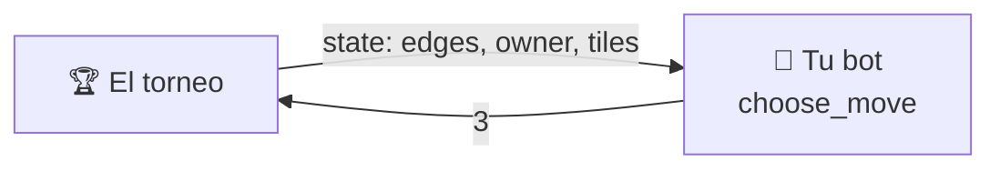

# API de jugador

Para crear tu propio jugador de BlackHole para este repositorio, solo debes implementar la clase `Player`.
En esta clase tienes un método que decide la jugada, esta será la estrategia de tu jugador.
Esta página te ayuda a escribir tu propio bot desde 0.

---

## Empieza copiando esto

Un jugador correcto y pequeño: colocar siempre las fichas en el nodo libre con
**más vecinos**. Cópialo, cámbiale el nombre y ya tienes un bot válido.

```python
from blackholearena.game import Move, State, adjacency, legal_moves
from blackholearena.player import Player


class HubBot(Player):
    @classmethod
    def get_name(cls) -> str:
        return "HubBot"

    @classmethod
    def get_authors(cls) -> list[str]:
        return ["tu nombre"]

    @classmethod
    def get_description(cls) -> str:
        return "Places its tiles on the free node with the most neighbours."

    @classmethod
    def get_icon(cls) -> str:
        return "🧲"

    def choose_move(self, state: State) -> Move:
        adj = adjacency(state)  # adj[v] = vecinos del nodo v
        return max(legal_moves(state), key=lambda node: len(adj[node]))
```

Ese bot juega partidas legales de principio a fin. Suele puntuar algo más que
`random`, pero es fácil de aprovechar: no mira dónde están las fichas de nadie
ni cuántas coloca. Aun así **compite**. A partir de aquí solo cambias
`choose_move`.

---

## Lo que acabas de implementar



Son cinco métodos: cuatro dicen **quién eres** y uno **juega**.

| Método | Devuelve | Qué es |
|---|---|---|
| `get_name()` | `str` | tu nombre, **único** entre todos los jugadores admitidos |
| `get_authors()` | `list[str]` | lista no vacía de nombres |
| `get_description()` | `str` | una o dos frases sobre tu *estrategia* |
| `get_icon()` | `str` | **un** emoji, que se muestra junto a tu nombre |
| `choose_move(state)` | `int` | la decisión: el nodo libre donde colocar tus fichas |

Los cuatro primeros son `@classmethod` porque el torneo, la web y la
documentación necesitan etiquetar a un jugador **sin construir uno**.

!!! note "Python no te deja olvidarte de ninguno"
    Los cinco son abstractos, así que una subclase incompleta falla al
    instanciarse, con un mensaje que dice cuál falta:

    ```text
    TypeError: Can't instantiate abstract class MyBot without an
               implementation for abstract method 'get_name'
    ```

!!! tip "Que el icono sea un solo glifo"
    Se renderiza en sitios que no admiten marcado (el marcador, un `<select>`
    nativo), y una secuencia de dos glifos rompe la alineación de las tablas.
    Los jugadores incluidos usan, por ejemplo, 🎲 `random`, 🌱 `easy` y 🤝
    `cooperative`.

---

## Los tipos exactos

### Lo que recibes: `state`

Un **diccionario** con el grafo y lo que hay en cada nodo:

```python
state = {
    "edges": [[0, 1], [2, 3], [3, 4], [0, 2], [0, 3], [1, 3], [1, 4]],
    "owner": [0, 1, None, None, None],   # nodo 0 → jugador 0, nodo 1 → jugador 1
    "tiles": [1, 1, 0, 0, 0],            # una ficha en cada uno
}
```

| Dato | Regla |
|---|---|
| Tipo | `dict` con tres claves: `edges`, `owner`, `tiles` |
| `len(state["owner"])` | número de nodos, *2N + 1*, numerados desde **0** |
| `state["edges"]` | las aristas `[a, b]` del grafo; no cambian en toda la partida |
| `state["owner"][v]` | `0`, `1` o `None` (nodo libre) |
| `state["tiles"][v]` | fichas en el nodo `v` (`0` si está libre) |
| Partida terminada | **nunca** la recibes: siempre queda al menos una jugada |

Es de **solo lectura**: no lo modifiques. Si quieres explorar el futuro, usa
`apply_move`, que devuelve un estado nuevo.

### Lo que devuelves: la jugada

Un **`int`**: el índice del nodo libre donde colocas tus fichas.

```python
return 3              # coloca las fichas de este turno en el nodo 3
```

No dices cuántas fichas: eso lo fija el turno (ver `tiles_to_place` abajo). Una
jugada es **legal** exactamente cuando:

```text
0 <= node < len(state["owner"])   Y   state["owner"][node] is None
```

La única fuente de verdad es `blackholearena.game.is_legal`. Devuelve un `int`
de verdad: los booleanos, las tuplas, las cadenas o un nodo ocupado se rechazan.

---

## Herramientas para escribir tu bot

Tu bot puede importar funciones puras de `blackholearena.game`. No tienes que
reimplementar ninguna de estas:

| Función | Para qué |
|---|---|
| `legal_moves(state)` | los nodos libres en los que puedes jugar |
| `is_legal(state, move)` | comprobar una jugada |
| `apply_move(state, move)` | un estado **nuevo** con la jugada aplicada (sin mutar) |
| `is_terminal(state)` | `True` si la partida ha terminado |
| `adjacency(state)` | `adj[v]`: la lista de vecinos de cada nodo |
| `neighbors(state, v)` | los vecinos de un solo nodo |
| `free_nodes(state)` | los nodos libres, también en un estado terminado |
| `to_move(state)` | **quién eres**: `0` si saliste primero, `1` si segundo |
| `tiles_to_place(state)` | **cuántas fichas** vas a colocar con esta jugada |
| `turns_per_player(state)` / `tiles_per_player(state)` | *N* y *M* del grafo actual |
| `scores_if_hole(state, node)` | **qué puntuaría** cada jugador si `node` fuera el agujero negro ahora |

Tres de ellas son las que convierten una idea en una estrategia:

- **`to_move`** te dice qué jugador eres. Lo necesitas para leer `owner`
  (cuáles son *tus* nodos) y para quedarte con *tu* componente de una
  puntuación.
- **`tiles_to_place`** te dice cuánto vale la jugada actual: 1 ficha en tu
  primer turno, *N* en el último. Una jugada de pocas fichas puede servir para
  «reservar» un nodo; una de muchas es la que decide tu puntuación.
- **`scores_if_hole`** responde «¿cuánto puntuaría cada uno si la partida
  acabara aquí con este nodo como agujero negro?», contando solo las fichas ya
  colocadas. Es la base natural de una heurística, y es lo que muestra el modo
  rayos X de la [página web](../advanced/web.md).

!!! example "Una heurística de una jugada"
    Para cada jugada posible, mira cuánto puntuarías de media según cuál de los
    nodos que siguen libres acabe siendo el agujero negro:

    ```python
    from blackholearena.game import (apply_move, free_nodes, legal_moves,
                                     scores_if_hole, to_move)

    me = to_move(state)

    def average_score(node: int) -> float:
        after = apply_move(state, node)
        holes = free_nodes(after)
        return sum(scores_if_hole(after, h)[me] for h in holes) / len(holes)

    best = max(legal_moves(state), key=average_score)
    ```

    No mira lo que hará el rival después, así que es solo un punto de partida.

!!! tip "Calcula la adyacencia una vez por jugada"
    `adjacency(state)` recorre todas las aristas. Si tu bot explora muchas
    posiciones, llámala una vez al principio de `choose_move` en vez de llamar a
    `neighbors` dentro de un bucle: el grafo no cambia durante la partida.

---

## Las reglas del entorno

El contrato es diminuto, pero el torneo que llama a tu bot tiene sus propias
reglas. No aparecen en ninguna firma de método, así que es fácil olvidarlas.

### Tienes un presupuesto de tiempo por partida

**2 segundos para toda la partida**, no por jugada. Es acumulativo: puedes
quemar 1,5 s en una posición difícil y jugar el resto al instante. Hay un
segundo presupuesto aparte de 2 s para construir tu jugador.

!!! warning "El tiempo se mide en los runners de GitHub"
    Son más lentos y más variables que tu portátil. Un bot que cabe en el
    presupuesto en local todavía puede agotar el tiempo en la ejecución
    oficial. Escribe código eficiente.

### Cada fallo cuesta esa partida, nunca la ejecución

| Qué hiciste | Se registra como |
|---|---|
| Superaste tu presupuesto de partida, o te colgaste | `forfeit_timeout` |
| Lanzaste una excepción al elegir jugada | `forfeit_error` |
| Devolviste algo que no es un nodo libre | `forfeit_illegal` |
| Superaste el presupuesto al construirte | `forfeit_build_timeout` |
| Lanzaste una excepción al construirte | `forfeit_build_error` |

En todos los casos la partida se corta: **tú puntúas 0** en ella y tu rival
puntúa el máximo posible, *M* (todas sus fichas). Se registra el motivo y el
torneo continúa. Nunca se cae por tu culpa — pero un bot que falla no se
fusiona.

### Tu estado vive dentro de una partida

Las cachés, tablas de memoización y la posición de tu generador aleatorio
persisten de jugada a jugada **dentro de su propia partida**, y desaparecen al
terminarla. No intentes arrastrar nada entre partidas.

!!! warning "Mantenlo pequeño"
    No busques historial de jugadas, temporizadores ni la identidad del rival
    dentro de `choose_move`. Eso pertenece al *torneo que te llama*, no al
    contrato. **Un jugador es una función pura del tablero.**

---

## Si tu bot usa azar: `create(seed)`

El torneo construye todos los jugadores llamando a `create(seed)`, nunca a la
clase directamente. Por defecto hace `cls()`, así que **puedes ignorarlo**. Si
tu bot usa azar o necesita configuración, sobreescríbelo:

```python
@classmethod
def create(cls, seed: int) -> "MyBot":
    return cls(depth=4, seed=seed)
```

Usar la semilla que te dan hace que tus partidas sean reproducibles: la misma
ejecución del torneo da el mismo resultado dos veces.

---

## Extras opcionales

??? tip "Reutilizar una de nuestras estrategias en vez de escribir la tuya"
    Las estrategias que hay detrás de los jugadores de referencia son API
    pública en `blackholearena.bots`: `RandomBot` (🎲 `random`, la base que todo
    jugador debería superar), `FreeNeighbourBot` (🌱 `easy`), `SearchBot` y sus
    tres utilidades, `MaxOwnBot`, `MinRivalBot` y `CooperativeBot` (⚔️
    `aggressive-max`, 🗡️ `aggressive-min` y 🤝 `cooperative`). Están todas en la
    [referencia de la API](../advanced/api.md#estrategias-reutilizables). Puedes
    heredar de cualquiera y sobreescribir sus métodos. Cada jugador incluido es
    solo eso: esto es `players/builtin/random.py` al completo, que solo añade la
    identidad.

    ```python
    """The `random` player — difficulty level 0, the baseline."""

    from __future__ import annotations

    from blackholearena.bots import RandomBot


    class Random(RandomBot):
        """Places its tiles on a uniformly random free node."""

        @classmethod
        def get_name(cls) -> str:
            return "random"

        @classmethod
        def get_authors(cls) -> list[str]:
            return ["builtin"]

        @classmethod
        def get_icon(cls) -> str:
            return "🎲"

        @classmethod
        def get_description(cls) -> str:
            return (
                "Places its tiles on a free node chosen uniformly at random. No "
                "strategy at all — the baseline every other player has to beat."
            )
    ```

    Puedes ver el código fuente
    [aquí](https://github.com/jparisu/blackhole-arena/blob/main/players/builtin/random.py).

    **Una búsqueda propia escribiendo solo la utilidad.** Los tres jugadores de
    búsqueda (⚔️ `aggressive-max`, 🗡️ `aggressive-min` y 🤝 `cooperative`) son
    subclases de `SearchBot`, la búsqueda alfa-beta con memoización que se
    explica en [El torneo](../advanced/tournament.md#como-juegan-los-jugadores-de-busqueda).
    Si heredas de ella solo tienes que escribir dos métodos, además de la
    identidad de siempre:

    - `utility(mine, theirs)`: cuánto te gusta un par de puntuaciones finales
      (o estimadas).
    - `utility_bounds(best)`: el valor mínimo y máximo posible de esa utilidad,
      siendo `best` lo máximo que puede puntuar un jugador en ese grafo. Tienen
      que ser cotas **reales**: la poda alfa-beta parte de ellas.

    Y, si quieres, el atributo de clase `cooperative`: `False` (por defecto)
    supone que el rival minimiza tu utilidad; `True`, que la maximiza.

    ```python
    from blackholearena.bots import SearchBot


    class Margin(SearchBot):
        """Maximizes the score difference, against a hostile opponent."""

        def utility(self, mine: float, theirs: float) -> float:
            return mine - theirs

        def utility_bounds(self, best: int) -> tuple[float, float]:
            return (-float(best), float(best))

        # ... get_name, get_authors, get_description y get_icon, como siempre
    ```

    El presupuesto de nodos por jugada se cambia en `create`, con
    `return cls(max_nodes=10_000, seed=seed)`. El valor por defecto (30 000)
    está pensado para el presupuesto de tiempo del torneo en CI; subirlo puede
    costarte partidas por tiempo. La heurística del límite de profundidad,
    `expected_scores`, es una función del módulo que la búsqueda llama
    directamente, **no** un método que puedas sobreescribir: tu utilidad sí
    decide cómo se valoran sus estimaciones, pero para cambiar la estimación en
    sí tienes que escribir tu propia búsqueda (puedes reutilizar
    `expected_scores` y `search_depth` desde ella). `SearchBot` ya rellena
    `last_info`, así que la página web muestra lo que buscó en cada jugada.

    Reutilizar una estrategia está permitido, pero escribir tu propio bot es el
    ejercicio de verdad.

??? tip "Publicar tu razonamiento para la página web"
    Si tu bot rellena un diccionario `self.last_info` tras cada jugada (por
    ejemplo, con la profundidad explorada o la puntuación esperada), la
    [página web](../advanced/web.md) lo recibe junto a la jugada y puede
    mostrarlo. Nunca es obligatorio: el torneo lo ignora.

---

**Siguiente:** [Enviar un jugador](submit-a-player.md) — el flujo de pull
request, paso a paso.
